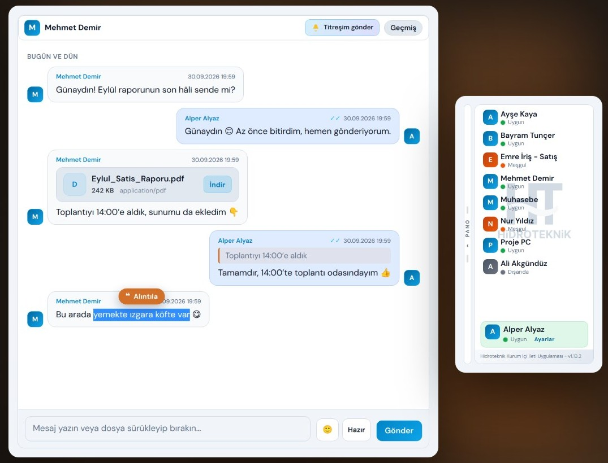
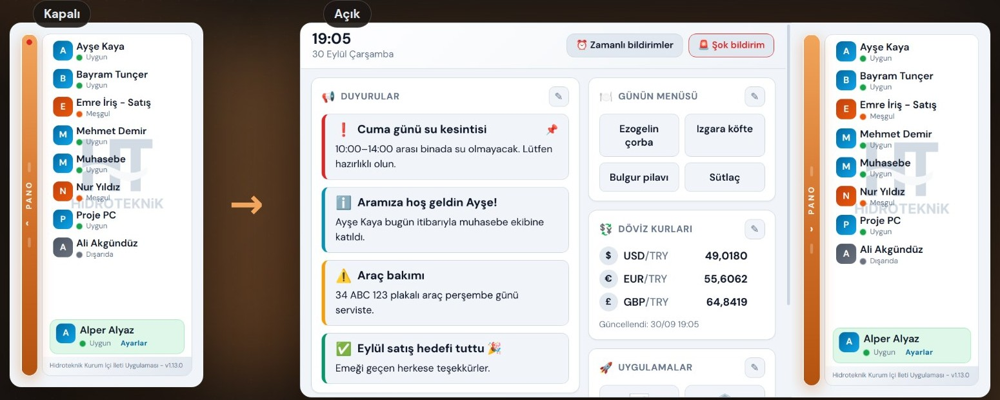
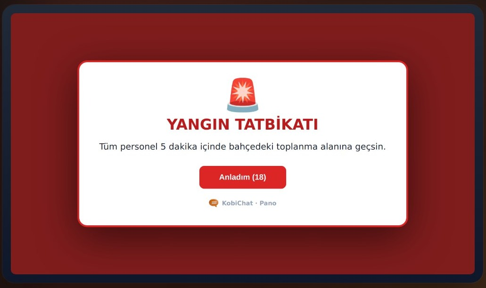

# KobiChat

🇬🇧 English · 🇹🇷 [Türkçe](README.tr.md)

**Office chat and file sharing that stays on your local network.**

One computer in the office runs the server, everyone else connects to it, and nothing
goes through the internet. No accounts, no cloud, no subscription. Messages and files
are stored on a PC you own.

Built at [Hidroteknik](https://www.hidroteknik.com.tr), a hydraulics and pneumatics
company in Denizli, Türkiye, and used there every day.

**Get it:** [Microsoft Store](https://apps.microsoft.com/detail/9N01GLSS1KBJ) ·
[Windows installer](https://github.com/alperalyaz/kobichat/releases/latest)



The screenshots show the Turkish interface with sample names and messages.

## What it does

**Chat**

- One-to-one conversations, each in its own window, with typing and read indicators
- File sharing by drag and drop, up to 80 MB per file
- Messages to people who are offline wait on the server and arrive when they connect
- Bulk message: select several people with Ctrl and write to all of them at once
- Status (Available, Busy, Away) and a "vibration" to get someone's attention
- Quick messages on Ctrl+1 to Ctrl+7, message search, conversation history
- Light and dark theme, profile pictures, notification sounds by category
- English, Turkish, German, French and Spanish

**Board**

A drawer next to the contact list that the whole office sees:

- Announcements and notes
- Today's menu, loaded a month at a time
- Exchange rates (off by default, this is the only feature that uses the internet)
- Shortcuts to the apps and links your team uses
- Scheduled notifications such as work hours, birthdays and celebrations
- An urgent notice shown full screen, in red and with sound, on every open computer

The board can only be edited from the computer that runs the server.





## Setting it up

1. Install KobiChat on every computer.
2. On the computer that will be the server, open Settings and choose
   **Run server on this PC**. Leave that computer on during work hours.
3. On the other computers, choose **Connect to remote server** and enter the server's
   IP address, for example `192.168.1.10`.

The server listens on TCP port 3847. The installer tries to add a Windows Firewall rule
for it. If the others cannot connect, allow that port by hand.

Server data (messages and files) lives in `%AppData%\kobichat\server-data`. To move the
server to another PC, close the app and copy that folder.

By default, text messages are kept for 90 days and files for 7 days. These and other
limits can be changed with environment variables, listed in
[ENV_RELEASE.example.txt](ENV_RELEASE.example.txt).

### Running the server on its own

The server also runs without the desktop app, which suits a machine that is always on:

```bash
npm install
npm start
```

Check which version a server is running at `http://<server>:3847/api/server-meta`.
A standalone server is not updated by the app. Each
[release](https://github.com/alperalyaz/kobichat/releases) includes
`KobiChat-Sunucu-Guncelle.cmd`, which updates it in place.

## What to know before you rely on it

- **It trusts your network.** There are no passwords. People choose a display name and
  anyone on the LAN who can reach the server can join. Traffic is plain HTTP and is not
  encrypted. Use it on an office network you control and do not expose port 3847 to the
  internet.
- **Windows only**, 64-bit. The Store version needs Windows 10 or 11.
- **The installer is not code signed**, so Windows SmartScreen warns on first run.
  The Microsoft Store version does not have this problem.
- **Updates come through the Microsoft Store.** The installer version does not update
  itself.
- **One server.** There is no failover: if the server PC is off, chat is down.

## Development

You need [Node.js](https://nodejs.org) 18 or newer.

```bash
npm install
npm run dev      # Vite + Electron with hot reload
npm run setup    # build the Windows installer into release/
```

Smoke tests for the server:

```bash
npm run test:single-server   # offline queue and redelivery
npm run test:history         # message ordering
npm run test:cluster         # durable log and idempotency
```

## How it is built

| Part | Technology |
|---|---|
| Desktop app | Electron 22, React, Vite |
| Server | Express, Socket.IO |
| Storage | SQLite through `sql.js`, files on disk |
| Packaging | electron-builder (NSIS installer and Microsoft Store `.appx`) |

`electron/` holds the main process, `server/` the chat server and the board,
`src/` the interface. A push to `main` builds and publishes a release through
GitHub Actions.

## License

[MIT](LICENSE) © 2026 Hidroteknik A.Ş.

---

Developed by Alper Alyaz for [Hidroteknik](https://www.hidroteknik.com.tr).
